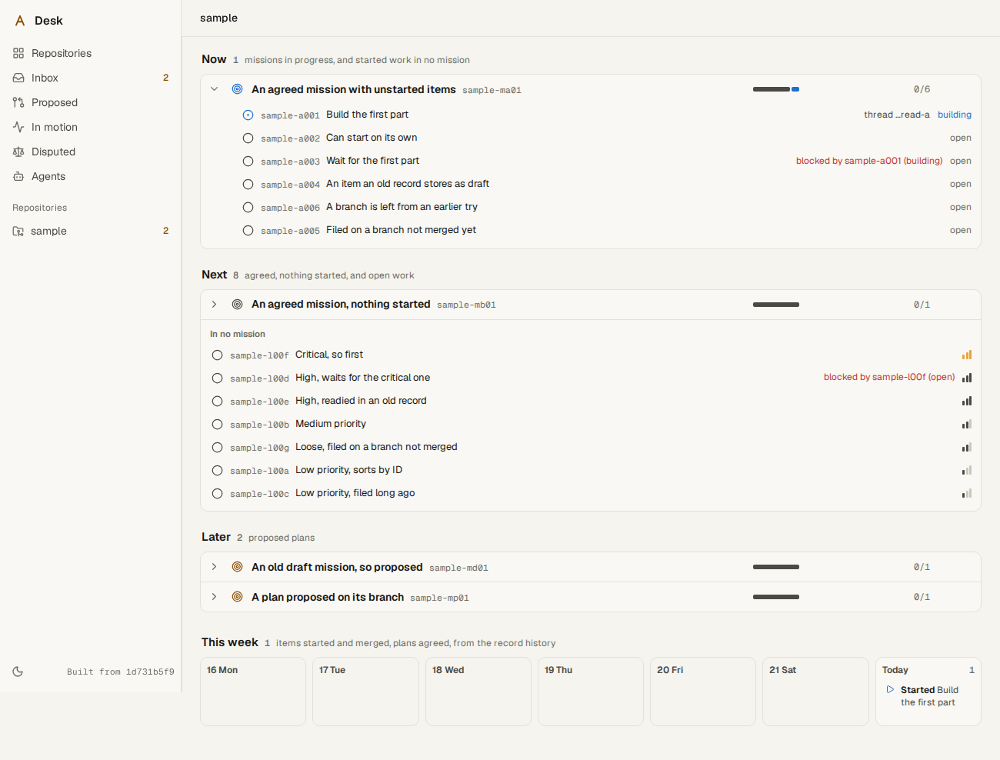
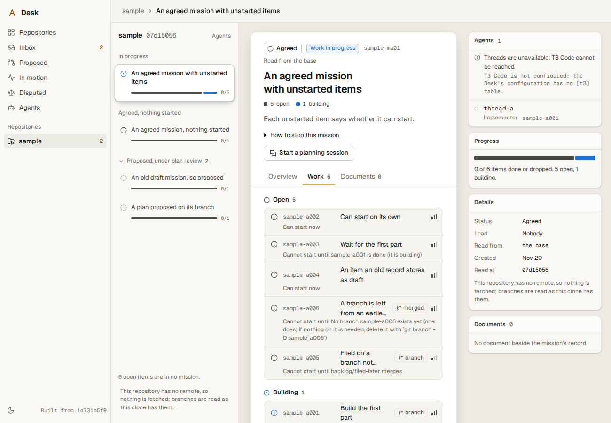
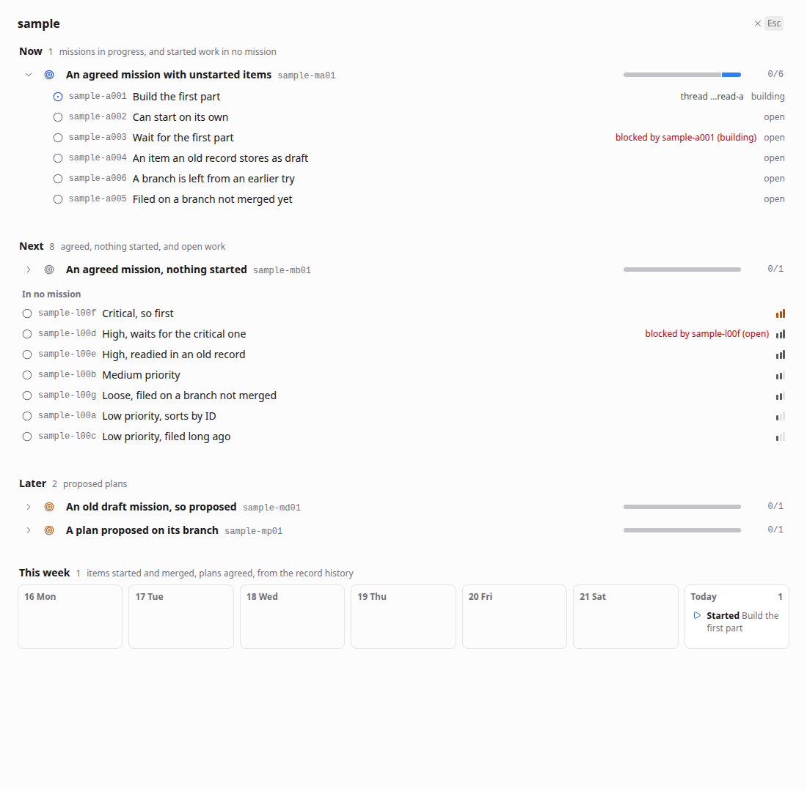
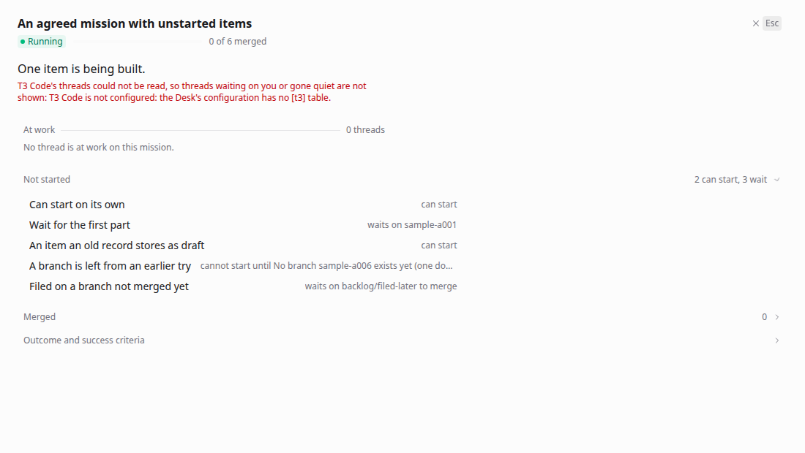

## Goal

The Desk and the T3 extension sort unstarted items by `draft` and `ready`:
the Desk's project page splits loose items into next and later, the
extension's home page puts ready items in "Next" and drafts in "Later", and
its mission page counts drafts apart from items that can start. Once
atelier-v06d merges every unstarted item is `open`, and these pages should
say so. The human chose on 2026-11-19 to give up the next and later split
for loose items, which was the ready mark.

## Done when

- [x] No page of the Desk's app or the extension shows the word draft or
  ready as an item's status, and `Status` in `desk/src/api` has `open` in
  place of both.
- [x] Loose open items are one list on the Desk's project page and on the
  extension's home page, ordered by priority and then ID.
- [x] A mission's page says of each unstarted item whether it can start or
  what it waits on, and counts no drafts.
- [x] A proposed mission and an agreed one still look different, by the
  mission's own state and not by an item status borrowed for it
  (`desk/src/lib/words.ts` maps a proposed mission to `draft` today).
- [x] `pnpm test` and `pnpm e2e` pass in `desk/`, and `node
  t3-extension/run-tests.mjs` passes against a Desk built from this branch.
- [x] The Report holds a screenshot of the project page and of a mission
  page with unstarted items, from the Desk and from the extension.

## Scope

`desk/src`, `t3-extension/src`, their tests, and `docs/product/desk.md` and
`docs/architecture/desk.md` where they describe these pages. No new page,
lane, filter or control. Not the Desk's server, which atelier-v06d changes.

## Report

Both project homes now list loose open items as one list, most urgent
first, and both mission pages say of each unstarted item that it can start
or what it waits on. No page shows `draft` or `ready` as an item's status.
atelier-v06d had already put `open` in `Status` and merged the two lanes;
these are the gaps it left.

### What changed

- **The loose list's order (9b69dcb02).** `GET /api/roadmap` is not ordered
  by priority: it was out of that order in four of the five repositories the
  Desk serves. Each page shows eight before "Show more", so urgent items
  could be hidden. Both now sort by priority, then ID.
- **What an unstarted item waits on (46bacdbd2).** Two faults. An item that
  only exists on an unmerged branch gave no reason on the Desk and "waits on
  others" in the extension. And the Desk printed an unmet condition as a
  fact, "X is done (it is building)". The Desk now says "Cannot start until"
  before each, and adds the branch's merge. The extension says "waits on"
  with the blockers and the branch, or else names the failing condition.
- **Mission control too (46bacdbd2).** It is where the Desk's project page
  sends a mission's title until atelier-yy4j removes it, so its rows say
  "can start" or "waits" and the selected item lists why.
- **The three wordings atelier-v06d left (6b614601f).** The item page shows
  "Readied" only where an old record says who, where it said "Ready: Not
  yet". Both glances say "Nothing can start now", and the project strip
  "Nothing can start". A proposed mission's glyph is keyed by `proposed`,
  its own state, and looks as it did.

229c64438 fixes three expected counts in the extension's tests that the
fixture rows of the first two commits moved, so those tests fail on those
two commits alone.

### Screenshots

An `atelier-desk` and app built from this branch served a repository made
for this, with a blocked item, one filed on an unmerged branch, one with a
leftover branch, records stored `draft` and `ready`, and both kinds of
proposed mission. The extension's pages are its own components, built by its
Vite config and answered by that Desk, in headless Chromium and not inside
T3 Code. That Desk had no T3 Code configured, which is the red note.

The Desk's project page:

The Desk's mission page:

The extension's project home:

The extension's mission page, with Not started unfolded:

### Behaviour a reader may not expect

- The clients tell that an item is filed on a branch from its row: an
  unmerged `branch` not named for the item. The row has no `proposed`
  field, and the server is outside this item.
- A reason is the server's condition text, so an item of an old draft
  mission quotes "an old `draft`". That is the mission's stored status, not
  the item's.
- Mission control's progress log still says "Readied" of steps in old
  history. They are events, not a status.

### Left, for the lead

I filed none of these: `atelier new` is refused on an item's branch until
atelier-u6oy merges.

- The extension's hover card says "Blocked by" for blockers that are all
  done: `HoverCard.tsx` falls back to `blocked_by` when `waiting_on` is
  empty. Found by reading the code.
- The Desk's rail and its roadmap count loose items differently: the rail
  leaves out an item filed on an unmerged branch (46 against 47 here). The
  fix is in the server.
- The Desk's This thread draws a mentioned proposed mission as running,
  since `RecordName` carries no state. atelier-yy4j removes that page.

### Validation

Run on 229c64438, which has origin/master at cc62f7819 merged in.

- **Desk:** `pnpm typecheck`, `pnpm test`, `pnpm build` and `pnpm e2e` (138
  passed) exit 0.
- **Extension:** `pnpm typecheck`, `pnpm build`, `node run-tests.mjs` (7 of
  7, against a Desk built from this branch) and
  `scripts/t3-extension-release.test.sh` exit 0.
- **The real server:** on the screenshots' Desk, `desk-matches-cli` matched
  all 4 missions and the inbox, `atelier check` passed on its records, and
  both homes gave the same loose order.
- **Real records:** I saved the running Desk's answers for its five
  repositories with read-only GETs (this branch changes nothing under
  `crates/`) and replayed both new rules over their 386 open rows: 312 can
  start, and each of the other 74 names what it waits on.
- `cargo fmt -- --check`, `git diff --check` and `atelier check` exit 0.
- **Not run:** the Rust suite and clippy, as no Rust changed, and the
  extension inside T3 Code.
