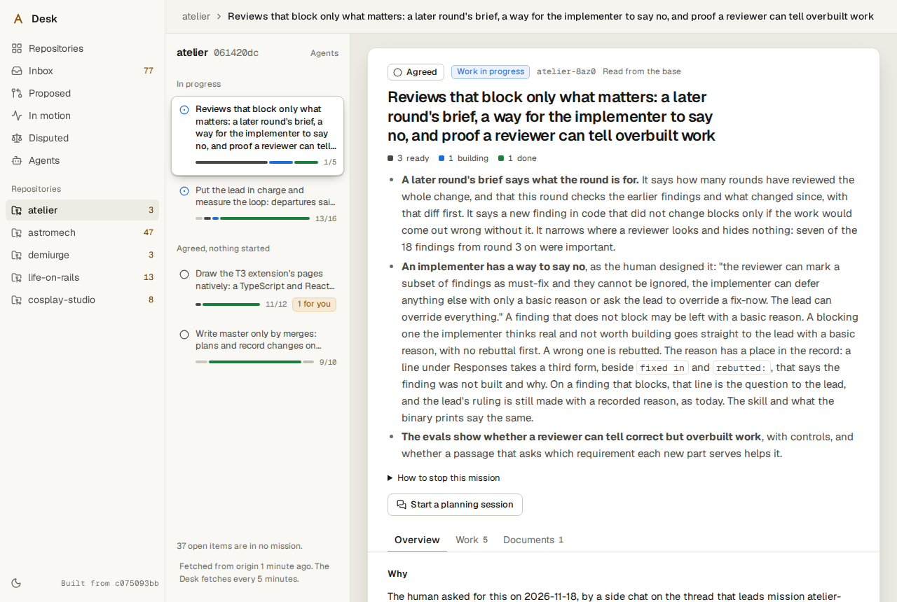
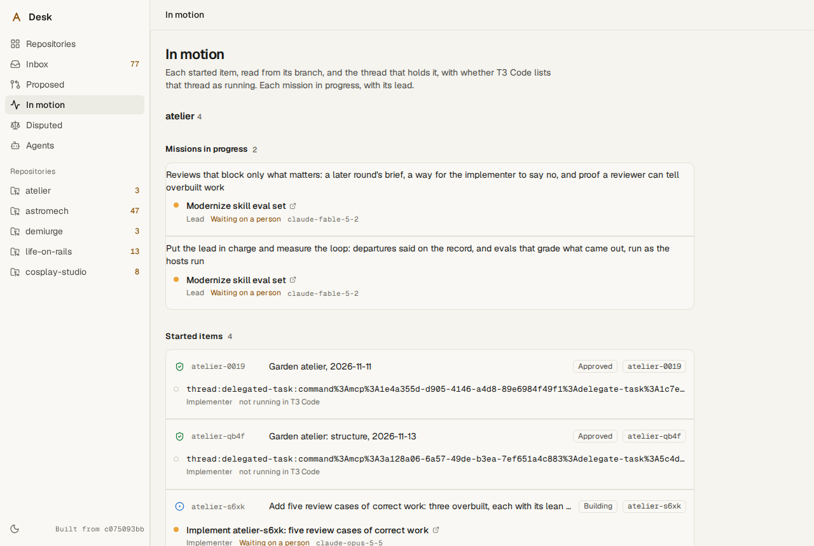
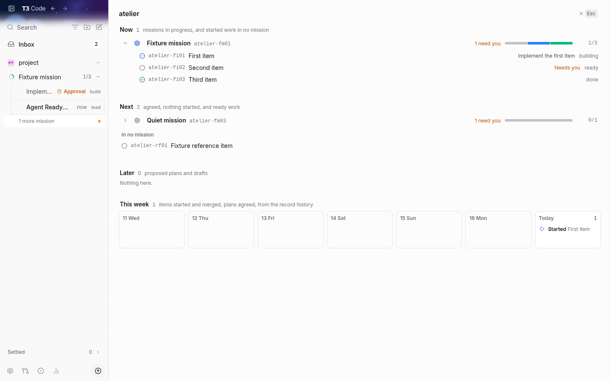

# Atelier

Atelier lets one person hand a batch of work to a fleet of coding agents,
walk away, and come back to code that was reviewed before it merged.

It is three things in one repository:

- **`atelier`**, a command-line tracker that agents use. It keeps its
  records as Markdown in Git, tells each agent thread what it holds and the
  next command, and merges a change to the code once an agent that did not
  write it has approved it.
- **[Agent Factory](skills/agent-factory)**, a skill that teaches agents how
  to decide: how to plan, implement, review, lead a mission and tend a
  repository.
- **[The Desk](desk/README.md)**, a web app for the human. It shows what is
  proposed and in motion across their repositories and lets them stop a
  mission. [An extension](t3-extension/README.md) shows it inside T3 Code.

Atelier starts no agent and calls no model. It runs under Claude Code, Codex
and T3 Code, and this repository is built with it: [`.atelier/`](.atelier)
holds its own missions, items and reviews.

<picture>
  <source media="(prefers-color-scheme: dark)" srcset="docs/images/desk-mission-dark.png">
  
</picture>

*The Desk's page for one of Atelier's own missions.*

## One change, from start to merge

An item is one change, on one branch, reviewed as a whole. This is one item
in a scratch repository, in the tool's own output, with long lines wrapped
and `[...]` where output is cut. The threads are named `alice`, `bob` and
`carol` here; a real thread is named by its harness's ID.

```console
$ atelier start --new "Greet the user by name"
Created demo-m82p and started it on branch demo-m82p.
[...]
```

The implementer writes the item's Goal and its Done when lines, makes the
change, ticks each line and writes a Report of what it did and how it checked
it. Then it submits:

```console
$ atelier submit
Submitted demo-m82p for review.
A reviewer must be a thread other than yours, and starting it is your job:
[...] Give it fresh context, not a fork of yours, and give it this task:
  In /home/alice/demo, run atelier review demo-m82p and follow what it
  prints.
Then wait for its verdict, and run `atelier status`.
```

Atelier does not start that thread. The implementer does, with its harness's
own tool, and the new thread gets the task line and nothing else:

```console
$ atelier review demo-m82p
You are the reviewer of demo-m82p (thread bob), round 1.
Review the change on branch demo-m82p as someone who did not write it: [...]
The author's reasoning is left out on purpose; judge what is there.
[... the item's Goal, Done when and Report, and the diff to read ...]
Your review file: .atelier/items/demo-m82p/reviews/1-yf33.md
[...]
```

The reviewer writes one finding, runs `atelier verdict changes`, and commits
its review file. The implementer's next `status` says what that means for it:

```console
$ atelier status
You are the implementer of demo-m82p (thread alice).
Item: .atelier/items/demo-m82p/item.md
Title: Greet the user by name
Status: changes requested in round 1
To return it to review:
  [ ] Finding 1-yf33.1 (fix now): A name with a space is cut at the first word
Answer each finding with one line under `### Responses` in the Report, [...]
`atelier submit` commits only the item's directory, so commit your change
first.
Then: atelier submit
```

It fixes the finding and submits again. A third thread reviews round 2 and
approves. The history so far is in Git, and `atelier log` reads it from
there:

```console
$ atelier log
2026-11-19T05:04:12Z fc5e675 demo-m82p start alice new -> building
2026-11-19T05:04:22Z 9447b82 demo-m82p submit alice building -> in_review
2026-11-19T05:04:29Z cf1ba69 demo-m82p review bob 1-yf33
2026-11-19T05:04:29Z cf1ba69 demo-m82p verdict bob 1-yf33 changes; in_review -> changes_requested
2026-11-19T05:04:34Z 1b0ad6b demo-m82p submit alice changes_requested -> in_review
2026-11-19T05:04:39Z 28c0d6b demo-m82p review carol 2-8om1
2026-11-19T05:04:39Z 28c0d6b demo-m82p verdict carol 2-8om1 approve; in_review -> approved
```

The implementer merges:

```console
$ atelier merge
main's config.toml names no merge check, so none ran.
Merged demo-m82p into main with merge commit dcf9f0b; it is done.
```

The item, both reviews and the change now sit together on `main`.

An item that is planned ahead takes one more step first: `new` writes it as
an open item, which any thread can start once that reaches the base.

## What the tool does

### It tells each agent where it is

An agent that has to find its place by running a command and reading the
refusal wastes its turns. `atelier status` answers first: who this thread
is, what it holds, what each thing still needs, and the next command. Claude
Code and Codex run it at the start of every session once `atelier setup
claude` or `atelier setup codex` has written their hooks.

A thread that runs another role's command gets one line back and nothing
changes. A refusal names the way out.

### Records are Markdown in Git, on the branch that does the work

```text
.atelier/
  config.toml
  missions/<id>/
    mission.md            Why, Outcome, Scope, Authority, Result
    reviews/1-k3fa.md     plan reviews
  items/<id>/
    item.md               Goal, Done when, Scope, Report
    reviews/1-x7qd.md     one file per review, with its findings and verdict
    artifacts/            screenshots and transcripts that back the Report
```

There is no database and no server to keep in step with the code. An item's
records travel on its branch and reach the base in the same merge as its
change, so any commit shows the code and what was agreed about it.

Only a merge writes the base branch. Every change, to code or to records, is
made on a branch that `atelier start` creates, so Atelier works on a
repository whose base is protected. There are three kinds of branch: one
named for an item, which holds its change and its records; one named for a
new mission, which holds its plan; and `backlog/<slug>`, for record changes
tied to neither, such as dropping an item. A new item is filed on whichever
of them its thread is on, and needs a backlog branch only where the thread
has none. A branch merges on what it holds:

| A branch that | Merges once |
| --- | --- |
| Changes code: any path outside `.atelier/`, or `config.toml` | An independent review approves its head. Only an item's branch may change code. |
| Adds a mission, or changes a mission's plan | Two plan reviews approve it, from threads that did not plan it |
| Changes only records, and no plan | `atelier check` passes on the merged tree. It needs no review. |

`atelier list` and `atelier show` read the base and every branch the clone
has fetched, and say which one each record came from.

### Every change to the code is reviewed by an agent that did not write it

- A thread that has implemented an item can never review it. The tool
  refuses, and prints the task to give a fresh thread.
- The reviewer gets a brief with the item's definition, the diff and the
  Report. The author's reasoning is left out on purpose.
- A finding is recommended as fix now, defer or no action. The implementer
  fixes a fix-now finding, or rebuts it once with a fact or a test, and a
  fresh reviewer keeps the finding or withdraws it. The implementer cannot
  dismiss one itself.
- A review records the model that wrote it, when the reviewer names one, so
  an implementer and its reviewer can come from different labs and the
  record shows it.
- Two ways past a review exist, and both leave a reason on the record:
  `merge --trivial "<why>"` for a change whose correctness is evident from
  the diff, such as a typo, and a mission's lead, who may merge past a
  finding it has ruled on.
- `atelier list --disputed` prints every rebutted finding with what the next
  round made of it. `atelier list --deferred` prints the findings left for
  later, until each is taken into an item or dropped with a reason.

### A mission is a batch of work you can leave

A mission has an outcome, a scope, limits on what agents may decide without
you (its Authority), and an end. You give its direction in conversation with
a planner, which writes the plan and its items on a branch. Two reviewers
that did not plan it review the plan blind, from different labs where two
are available, and it merges once both approve. Nobody says go after that.

A lead thread then runs the mission. `atelier lead` prints where each item
stands and the task that starts each one that can start. Items merge to the
base one at a time, so the base always shows the mission as it is. The lead
settles what its implementers and reviewers cannot, and closes the mission
with a written Result. You can stop a mission at any point with `atelier
drop`.

### Merge checks what will land

`atelier merge` merges an approved item, and checks first that the approval
still covers the branch's head: nothing outside the item's own records
changed since the reviewed commit but to file new items. It runs the project's merge checks from
`config.toml` on the merged tree. It reads that file from the base, so a
branch cannot weaken its own checks. With GitHub as the forge, `submit`
opens the pull request so that CI runs during the review, and `merge` waits
for CI for up to 9 minutes, then has GitHub merge the pull request. Exit
status 3 means "not yet": run it again.

### Rules are nudges, and every one can be skipped on purpose

Git hooks guard the rules where the action happens: pre-commit validates
each record a commit changes, pre-push keeps the base to merges, and
post-checkout prints `status` for the branch just switched to. Any rule a hook or a command applies can be passed
with a reason, which is printed and recorded:

```console
$ ATELIER_SKIP="the reviewer is down and the human said to merge" atelier merge
```

### A dead thread strands nothing

Agent threads stall and die. Any command that binds a role can take that
role over from the thread that held it: `start <id>` on a started item,
`review <id>` on a review with no verdict, `lead <mission>`. The record
keeps who held it before, so a former implementer still cannot review.

### A gardener keeps the repository workable

A garden run looks hard at one area of a repository, such as its tests, its
structure or how work flowed, through the code and the threads of the agents
who worked there. It brings you one page with at most three proposals, each
a cause with counted evidence. It is an item like any other, labelled
`garden`, and its facts come from `atelier log` and the review records.

### The commands

| Who | Commands |
| --- | --- |
| Anyone | `status`, `show`, `list`, `log`, `check`, `new` |
| Planner | `start --mission`, `start --backlog`, `set`, `drop`, `close` |
| Implementer | `start`, `submit`, `merge` |
| Reviewer | `review`, `verdict` |
| Lead | `lead` |

Only `start`, `submit` and `merge` act on Git, and they work on a mission's
or a backlog branch as they do on an item's. The others write files and
print the Git command that commits them. `atelier <command> --help` says what
each does, and the [product specification](docs/product.md) defines all of
it.

## Agent Factory, the skill

The tool holds procedure, and the skill holds judgment. `atelier status`
says what to run, and [Agent Factory](skills/agent-factory/SKILL.md) says how
to decide: a file for each role (planner, implementer, reviewer, lead) and
procedures for a backlog pass, a readiness check and a garden run. Install it
for your agents with Vercel's `skills` CLI:

```bash
npx skills add spadaval/atelier --skill agent-factory -g
```

The skill acts only in repositories tracked with Atelier. Anywhere else it
tells the agent to stop using it and do the task directly.

## The Desk, the human's tool

Agents never read the Desk, and no check or merge consults it. It exists so
that the human never has to ask where things stand. One service per host
reads every repository it is given, and fetches each remote on a timer, so
work pushed from another machine shows up too.

- **Repositories** and **a mission's page**: each mission's why, outcome,
  documents, items and plan reviews, read from its branch while it is still
  proposed, with a button that stops a proposed plan.
- **Proposed**: every plan waiting on its reviews, and every other branch
  that changes records.
- **In motion**: every started item with the thread that holds it, and
  whether T3 Code lists that thread as running.
- **Disputed**: where two models disagreed, and what came of it.
- **Inbox**: the short list of things only the human can do.

<picture>
  <source media="(prefers-color-scheme: dark)" srcset="docs/images/desk-in-motion-dark.png">
  
</picture>

It is a Rust server, `atelier-desk`, that links the tracker's own core, and
a React app in [`desk/`](desk/README.md). What it is for is in its [product
intent](docs/product/desk.md), and its API in
[docs/architecture/desk.md](docs/architecture/desk.md).

## Inside T3 Code

[`t3-extension/`](t3-extension/README.md) puts the Desk where the threads
are, on Windows and macOS:

- **This thread**, in the panel beside whichever thread you are reading:
  what it holds, the missions it planned or leads, the threads it started,
  and what of that waits on you.
- **A mission page** and **a project home** over T3 Code's main area, drawn
  with T3 Code's own components.
- **Record links**: an ID such as `atelier-41zk` in a conversation becomes a
  link with a hover card.
- Missions and what needs you, in T3 Code's sidebar.

<picture>
  <source media="(prefers-color-scheme: dark)" srcset=".atelier/items/atelier-wvst/artifacts/home-t3-dark.png">
  
</picture>

*The project home on the extension's test fixture. The screenshot is a
validation artifact: the agent that built the page captured it for the
Report of item `atelier-wvst`, and it merged with the change.*

The extension uses private T3 Code interfaces, not a supported extension
API, and is released on its own `t3-extension-v*` tags.

## Evals

A change to the skill or to what the tool prints is a change to how agents
behave, so it is tested the way they run.
[`evals/agent-factory/`](evals/agent-factory/README.md) holds scenarios that
each put one agent under one pressure in a throwaway repository, and grade
the state it leaves behind:

- a reviewer handed an item whose new test passes on the old code, with a
  Report that says it failed first;
- a reviewer of 200 lines of hardening for a path that is planned for
  removal;
- a lead whose mission's Authority covers a decision an agent would rather
  hand back;
- twelve replays of changes from this repository's own history whose defect
  was found after merge, to see whether a review catches it now.

A run compares an arm with the skill against one without it, and a model
from another lab than the agent's judges whatever a script cannot. On every
change to the binary, the skill or the evals, CI checks that each scenario
still sets up and grades.

## Why it is built this way

Atelier was rewritten in November 2026 after an assessment of agent work
under its predecessor:

- Independent review caught real bugs: 39 of 100 sampled fix-now findings
  in four product repositories.
- The machinery around review cost more than it returned. 75% of commits
  touched only tracker records, and 38 of 50 sampled refusals were an agent
  tripping over the tool, not the tool stopping a mistake.
- The human asked "where are we?" 31 times in a month.

The cause was one gap: the old tool had gates and no map. So this one keeps
the review and cuts the rest. It shows state before it refuses, stores no
record that does not earn its place, and trusts its agents with a way past
every rule. The [product specification](docs/product.md) gives the
principles and the scorecard the tool is judged on, and the [design
record](docs/design.md) says how it is built and what was tried and removed.

## Install

On Linux (x86_64 or aarch64), install or upgrade to the latest release with:

```bash
curl --proto '=https' --tlsv1.2 -LsSf https://github.com/spadaval/atelier/releases/latest/download/atelier-cli-installer.sh | sh
```

The installer puts `atelier` in `$CARGO_HOME/bin` (`~/.cargo/bin` by default)
and, if that directory is not already on your `PATH`, adds it in your shell
profile; open a new shell to use it. Rerun it to upgrade. Releases, with
archives and checksums for each platform, are on
[GitHub](https://github.com/spadaval/atelier/releases), and the
[changelog](CHANGELOG.md) says what each changed. To build from a source
checkout instead, run `cargo install --path crates/atelier-cli --locked`.

Linux is the supported platform: every change is tested on it in CI, and
releases include Linux binaries only. Building from source on macOS may
work, but nothing tests it. Windows is not supported.

## Track a repository

Atelier needs one file, `.atelier/config.toml`, on your base branch:

```toml
schema_version = 3
slug = "demo"            # item and mission IDs begin with it: demo-m82p
base_branch = "main"

# Optional: commands `merge` runs on the merged tree.
[[merge_check]]
run = "cargo fmt -- --check"

# Optional: have GitHub make the merges. This needs `gh`, signed in.
[forge]
provider = "github"
remote = "origin"
ci_workflow = "ci.yml"   # optional; without it `merge` waits for no CI
```

Commit it together with your harness's session hooks, and push, before you
install the Git hooks. Once they are installed, the base takes nothing but
merges:

```console
$ atelier setup claude        # for Codex: atelier setup codex
$ git add .atelier .claude    # for Codex: git add .atelier .codex
$ git commit -m "Track with Atelier" && git push
$ atelier setup               # the Git hooks, in this clone
$ atelier status
You are thread alice, on the base branch main.
Nothing is open to start.
```

Run `atelier setup` once in every other clone. Then install the skill and
tell an agent what you want. For one change asked for directly it runs
`atelier start --new "<title>"`. For a batch it plans a mission with you,
with `atelier start --mission "<title>"`.

## Who it is for

Atelier is built for one person who runs coding agents on two Linux hosts
with T3 Code, and it is not designed for a second user. It is
public so that you can read it, borrow from it or run it. Expect what that
means: this page is the onboarding, GitHub is the only forge, and the
commands and the records change when its one user needs them to.

## What is in this repository

| Path | What it is |
| --- | --- |
| [`crates/atelier-core`](crates/atelier-core) | The tracker: records, the lifecycle, Git and the forge |
| [`crates/atelier-cli`](crates/atelier-cli) | The `atelier` command |
| [`crates/atelier-desk`](crates/atelier-desk) | The Desk's server |
| [`desk/`](desk/README.md) | The Desk's web app |
| [`t3-extension/`](t3-extension/README.md) | The T3 Code extension |
| [`skills/agent-factory/`](skills/agent-factory) | The skill |
| [`evals/agent-factory/`](evals/agent-factory/README.md) | The skill's evals and their recorded results |
| [`docs/`](docs/index.md) | The product specification, the design record and the Desk's documents |
| [`.atelier/`](.atelier) | Atelier's own missions, items and reviews |

To change something here, read [CONTRIBUTING.md](CONTRIBUTING.md): work goes
through an item, as everything above describes. Agents working in this
repository start from [AGENTS.md](AGENTS.md).

## License

[MIT](LICENSE).
